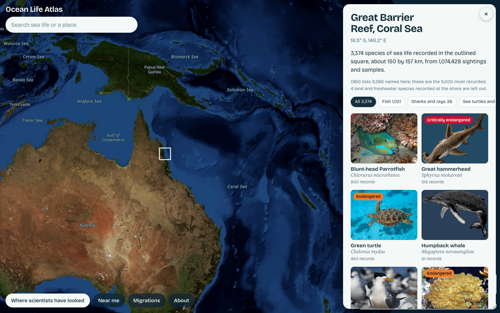
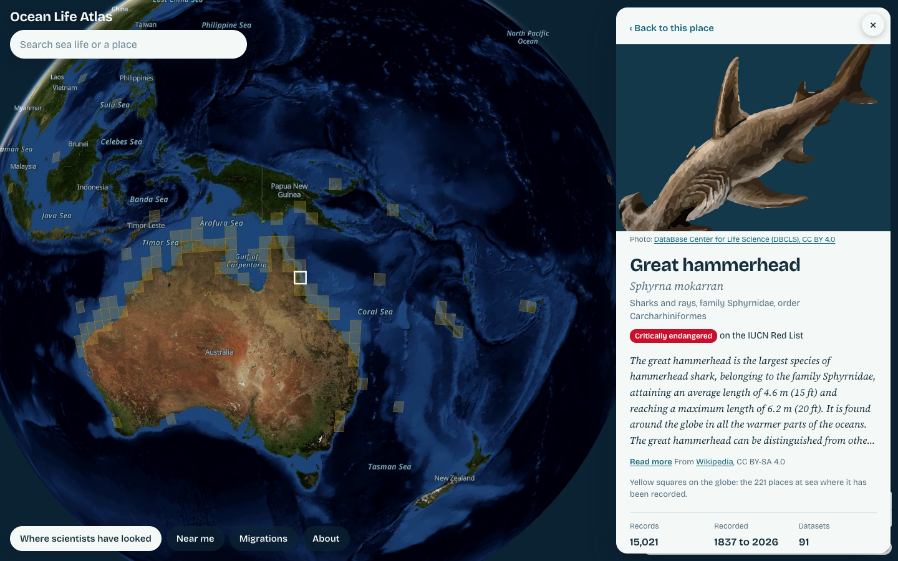
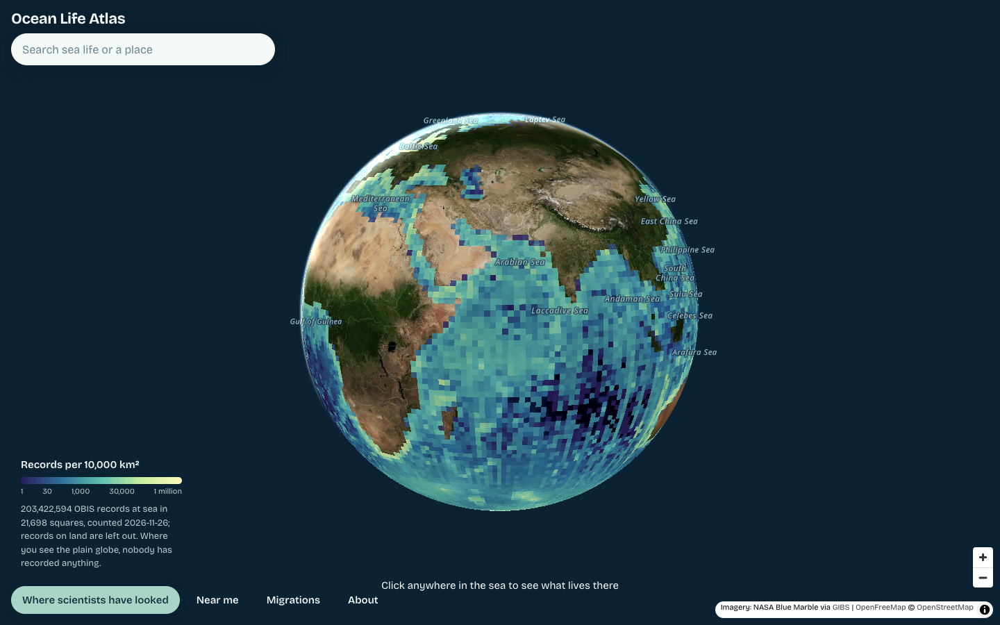
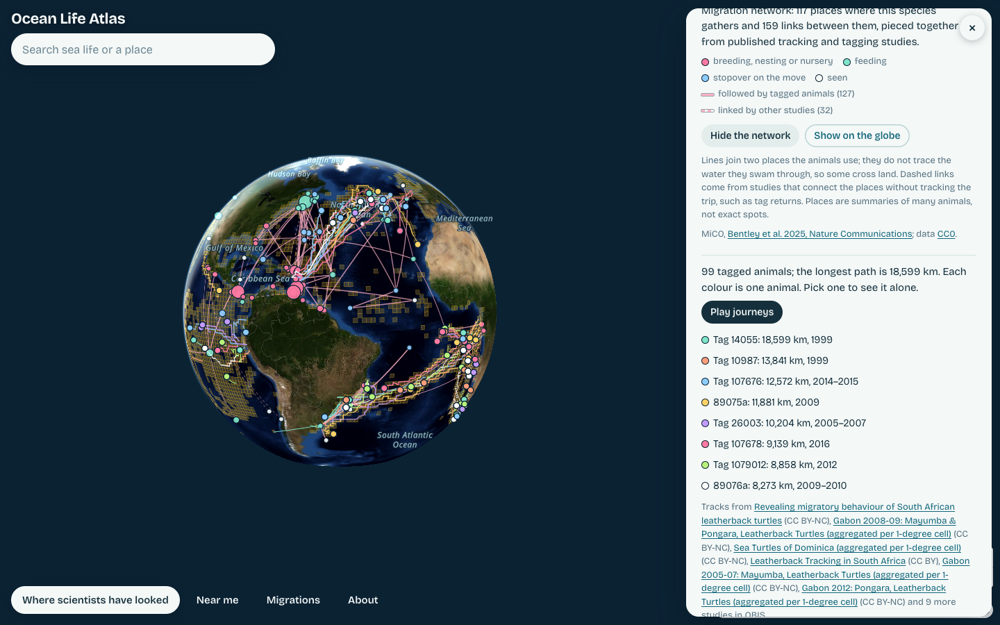
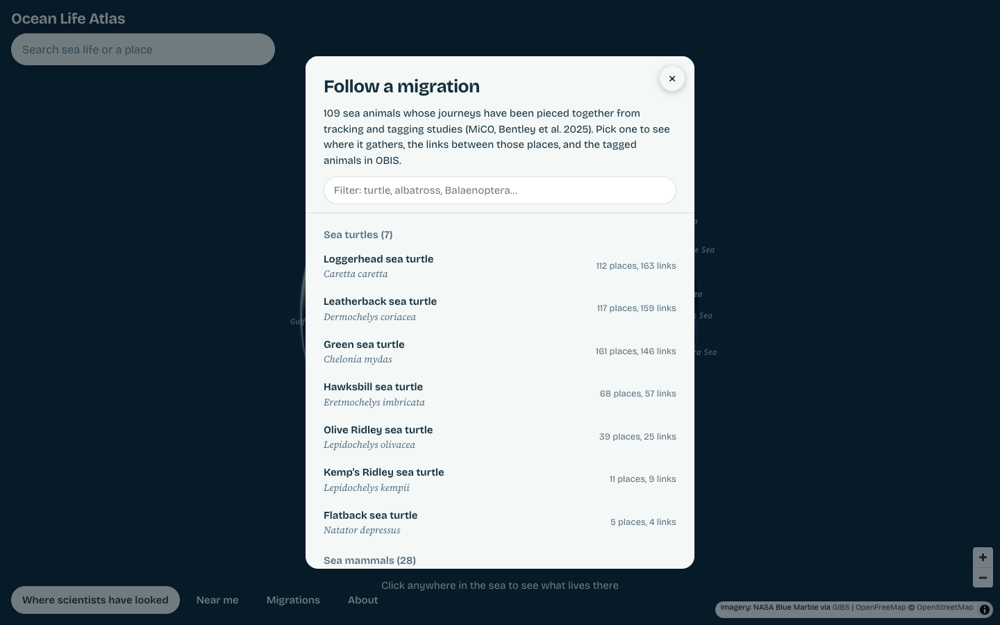
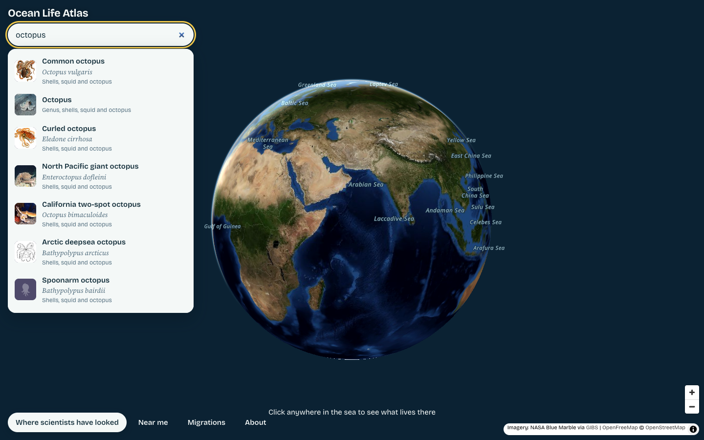
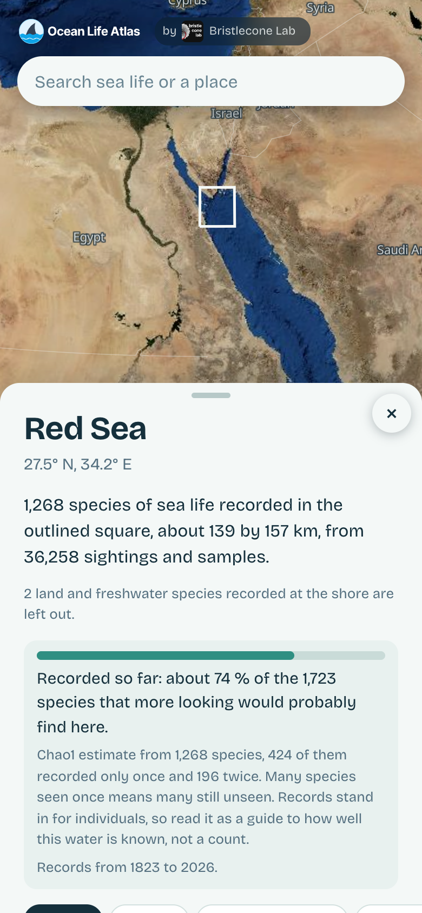

# Ocean Life Atlas

**Click the sea, see who lives there.** An open, plain-language atlas of ocean life on a 3D globe.

**Live: https://oceanlife.bristleconelab.org**

- Click any spot in the ocean (or *Near me*): the panel lists the sea animals and plants recorded within that 1.4°
  square (about 150 km across), with photos, everyday names, Red List status and a filter by kind (fish, sharks and
  rays, sea turtles, sea mammals, seabirds, corals, shells and octopus, crabs, starfish, seaweed and seagrass,
  plankton, sponges and worms). The mixed view leads with familiar species that have a photo.
- One search box for sea life and places: an everyday name in any language Wikidata knows ("octopus", "kit akula",
  "китовая акула"), a scientific name (*Rhincodon typus*), or a sea, gulf, island or reef ("Galapagos", "Red Sea",
  "Aral Sea"). A species page shows where it has been recorded, a photo, a summary from Wikipedia in the reader's
  language, how deep it usually lives and the sea surface temperature where it was recorded.
- **How it travels**, on species pages: the published migration network (places where the species breeds, feeds,
  stops over or spends a season, and the links between them, from MiCO; solid = followed by tagged animals, dashed =
  linked by other studies) and, on request, the paths of individual animals that carried satellite or acoustic tags.
  *Play journeys* runs all of them on one clock, "day N after tagging"; pick one animal to see it alone. Click a
  place, a link or a track on the globe to see what it is.
- **When it is recorded**: records by month, north and south of the equator apart (their seasons are opposite), with a
  tagged animal counted once a day; and records by decade.
- **Migrations** lists the 109 species with a mapped migration network, by kind of animal, with a filter.
- The globe has country borders and sea names (OpenStreetMap), Sentinel-2 imagery when you zoom in close, and every
  place and species is a step in the browser history, so Back works as expected.
- **How well is this water known?** Each square gets a Chao1 inventory-completeness estimate (how many more species more
  looking would probably turn up) and the years of its first and last record; *Where scientists have looked* can colour
  the squares by records per area or by how long ago anyone last recorded anything there.
- **Size and voice**: body length, weight and lifespan from Wikidata, drawn against a person, and a sound recording from
  Wikimedia Commons where one exists (humpback song, leatherback hatchlings).
- **Then and now**: a species' squares before 1990 and since 2010 on one map, with the change in average distance from
  the equator (and a plain warning that the surveys moved too).
- **Side by side**: compare two species (records, usual depth, surface temperature, Red List, where their ranges meet).
- **Take it with you**: the species list of a square as CSV, a range as GeoJSON, and a ready citation.
- **Tour**: seven stops, from the most-studied coasts to water nobody has looked at in fifty years.
- Interface in English and Uzbek (EN / UZ switch; animal names and Wikipedia follow the chosen language).
- Species without a photo get a drawn silhouette of their kind instead of a blank tile.
- Switch on **Where scientists have looked** to see how unevenly the ocean has been sampled. A short species list
  usually means few people have looked, not that little lives there, and the atlas says so.



| A species page | Where scientists have looked |
|---|---|
|  |  |

| How it travels: leatherback turtle | Follow a migration |
|---|---|
|  |  |

| Search by everyday name | On a phone |
|---|---|
|  |  |

Every place and species has its own link, for example
[`#at=-16.50,146.20`](https://oceanlife.bristleconelab.org/#at=-16.50,146.20) (a place) or
[`#sp=105817`](https://oceanlife.bristleconelab.org/#sp=105817) (a species).

## Why

The data already exists: [OBIS](https://obis.org) holds more than 260 million records of where marine species were
seen or sampled (about 203 million of them at sea once records flagged as on land are left out). But the tools built on it expect you to know Latin names and filter syntax: the OBIS Mapper opens on
an empty map that only accepts scientific names, AquaMaps is a 2019 site with a small static map, and GBIF's map shows
the whole planet as repeated dots. This atlas asks the two questions a curious person asks, "what lives here?" and
"where does this animal live?", and answers them with pictures and everyday words.

## How it works

The site is static: there is no server, and everything is fetched live by your browser from open services that allow
it.

| Question | Source |
|---|---|
| Which species were recorded in this square, how often, Red List status | OBIS API `checklist` (up to 5,000 taxa) and `statistics`, both with `exclude=ON_LAND`; species WoRMS marks as land- or freshwater-only are left out |
| Where a species has been recorded | OBIS API `occurrence/grid` (geohash-3 squares, `exclude=ON_LAND`) |
| How deep it lives | OBIS API `statistics/env`: the middle half of depth records (25th to 75th percentile, interpolated on OBIS's 10/100/1,000 m bin ladder); records above the surface are counted apart |
| Sea surface temperature where recorded | same answer, middle 80 % of the 5 °C bins |
| Search | WoRMS `AphiaRecordsByVernacular` and OBIS name completion (Latin script), Wikidata `wbsearchentities` (any language, mapped to WoRMS ids through P850), Marine Regions `getGazetteerRecordsByName` (places); species ranked by exact name, then same kind as the exact matches, then OBIS record count |
| Photo, everyday name in the reader's language, Wikipedia article | Wikidata through [QLever](https://qlever.dev) (Wikidata Query Service as fallback): by WoRMS id (P850), then by scientific name (P225), following old names to the accepted taxon (P12765); photo credits from the Commons API |
| Sea name for a point | Marine Regions gazetteer |
| Tracks of tagged animals | OBIS occurrence rows with `basisOfRecord` = MachineObservation and an `organismID` (satellite and acoustic tags, e.g. the US Animal Telemetry Network and IMOS). The API ignores a basis-of-record filter, so a 5,000-row sample finds the tracking studies; then whole studies are paged in (up to 40,000 rows, 40 studies) and studies that do not fit are skipped, never cut short. |
| Months and decades | months from the same random sample (OBIS orders rows by random UUID); decades from OBIS `statistics/years` |
| Migration networks | MiCO, stored in `public/data/mico/` (492 KB, 109 species, 1,706 links) by `npm run mico` |
| Globe | NASA Blue Marble through GIBS; Sentinel-2 cloudless 2016 by EOX (CC BY 4.0) from zoom 6; borders and names from OpenStreetMap vector tiles through OpenFreeMap |
| Inventory completeness | bias-corrected Chao1 from records per species in the square (shown only when the whole list fits in one answer, because the missing tail is exactly the rare species Chao1 needs) |
| Last looked at | `npm run data` also fetches the grid for records since 10, 20 and 50 years ago and stores the newest period per square |
| Size, lifespan, sound | Wikidata P2043 length, P2067 mass, P2250 life expectancy (largest value, units converted) and P51 audio; Commons MP3 transcode for Safari |
| Then and now | OBIS `occurrence/grid` with `enddate=1989-12-31` and `startdate=2010-01-01`; shift = change in the mean absolute latitude of the squares |

Two things are stored with the site:

- `public/data/records-gh3.json` (150 KB): OBIS records at sea (`exclude=ON_LAND`) in each of 21,698 geohash-3
  squares, for *Where scientists have looked*; the globe shows them per 10,000 km², because a square at 70° is a
  third the area of one at the equator. Rebuild with `npm run data` (about 10 s, checks the cell count).
- `public/data/mico/` (492 KB): one file per species with MiCO sites and links, keyed by WoRMS AphiaID. MiCO's route
  table has one row per route *and per pair of EEZs it touches* (25,241 rows); the build keys routes by the metasite
  ids and joins both directions, which leaves 1,706 links (1,177 followed by tagged animals). Rebuild with
  `npm run mico`: it downloads the Zenodo archive, checks its MD5, matches names through WoRMS (5 by a short list of
  known scientific names in the script) and fails if fewer than 90 species match.

## Honest limits

- A species list is a record of what was found, not a census. Record counts show where people looked and what they
  looked for: in the Great Barrier Reef square at 16.5° S, 146.2° E the most-recorded species are a 1 mm copepod and a
  single-celled dinoflagellate from plankton surveys, then a tern from bird counts (OBIS, 2026-11-26). The "All" view therefore takes each kind of life in turn (plankton and "others" less often) and leads with
  species that have a photo; the chips show each kind in full, most-recorded first.
- When a square holds more than 5,000 names (the Great Barrier Reef square holds 9,386), the panel says it shows the
  5,000 most recorded.
- Squares are 1.4° on a side, so a square at the coast also holds shore records; on land the panel says so. Records
  OBIS flags as on land are left out, but a wrong position at sea cannot be told from a right one and appears as it is.
- Depth: some datasets file the sea-floor depth under the animal's depth, which is why the text uses the middle half of
  records; the zone chart shows the full spread. Surface temperature is the water at the surface above the record, not
  where a deep animal lives, and the page says so for deep species.
- Tracks: tags only report where an animal was when a satellite or a listening station picked it up. Gaps longer
  than 20 days are left open. Fixes that would need more than a believable speed for the kind of animal (seabirds
  1,200 km a day, fish, sharks and whales 300, turtles 200, sea cows 100) are dropped; a bad first fix is found by
  starting from whichever early fix the most later fixes agree with; moves under 5 km do not add to the distance. Some
  studies round positions to 1° squares to protect the animals, which makes their paths look stepped. Tracking
  studies are found from a sample, so a very small study can be missed, and the page says "none in a random sample",
  not "none".
- MiCO places summarise many animals and studies; they are not exact spots. Its links join two places with a
  great-circle line, which shows that the places are connected, not the path swum, so some cross land.
- Interface text is in English; animal names and Wikipedia summaries follow the browser's language where Wikidata has
  them.
- Photos and names depend on Wikidata coverage. Where Wikidata has no everyday name, the English name from WoRMS is
  used; where neither exists, the scientific name is shown.

## Data licences

| Data | Licence |
|---|---|
| OBIS records | per dataset, mostly CC BY 4.0 or CC0; cite OBIS (2026) Ocean Biodiversity Information System, Intergovernmental Oceanographic Commission of UNESCO, https://obis.org |
| WoRMS names | CC BY 4.0, WoRMS Editorial Board (2026) World Register of Marine Species, https://www.marinespecies.org |
| Wikidata | CC0 |
| Photos | each file's own licence on Wikimedia Commons, shown with the photo |
| Wikipedia summaries | CC BY-SA 4.0 |
| Marine Regions | CC BY 4.0 |
| NASA Blue Marble | public domain |
| Borders and place names | © OpenStreetMap contributors, ODbL; tiles by OpenFreeMap |
| Close-up imagery | Sentinel-2 cloudless 2016 by EOX IT Services, CC BY 4.0 (contains modified Copernicus Sentinel data 2016) |
| Sounds | each file's own licence on Wikimedia Commons, shown with the player |
| MiCO migration networks | CC0 1.0; Bentley et al. (2025) Marine megavertebrate migrations connect the global ocean, Nature Communications, https://doi.org/10.1038/s41467-025-59271-7; data https://doi.org/10.5281/zenodo.14873514 |
| Tracking studies | each study's own licence (CC BY or CC BY-NC), named on the species page |

Code: MIT (see `LICENSE`).

## Development

```sh
npm install
npm run dev        # http://localhost:5173/ (scripts/screenshots.mjs expects port 5199: npx vite --port 5199)
npm test           # unit tests (geohash, grouping, depth and temperature, search ranking, places, names, licences, URL state, track cleaning, seasons, MiCO)
npm run build      # typecheck + production build in dist/
npm run shots      # regenerate docs/img/*.png from a running dev server (needs Google Chrome)
```

Pushes to `main` run the tests, build the site and publish it to Cloudflare Pages (project `ocean-life-atlas`,
`.github/workflows/deploy.yml`), using the `bristleconelab` organisation secret `CLOUDFLARE_API_TOKEN` (Cloudflare
Pages: Edit). Manual deploy: `npm run build && npx wrangler pages deploy dist
--project-name ocean-life-atlas --branch main`.

## Related

[Seafloor Atlas](https://seaflooratlas.org): the same globe idea for the ocean floor, and how much of it has actually
been measured.
