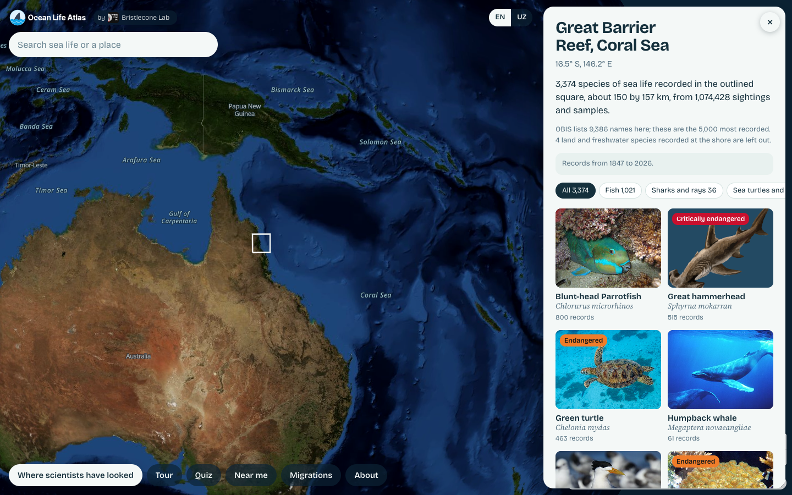
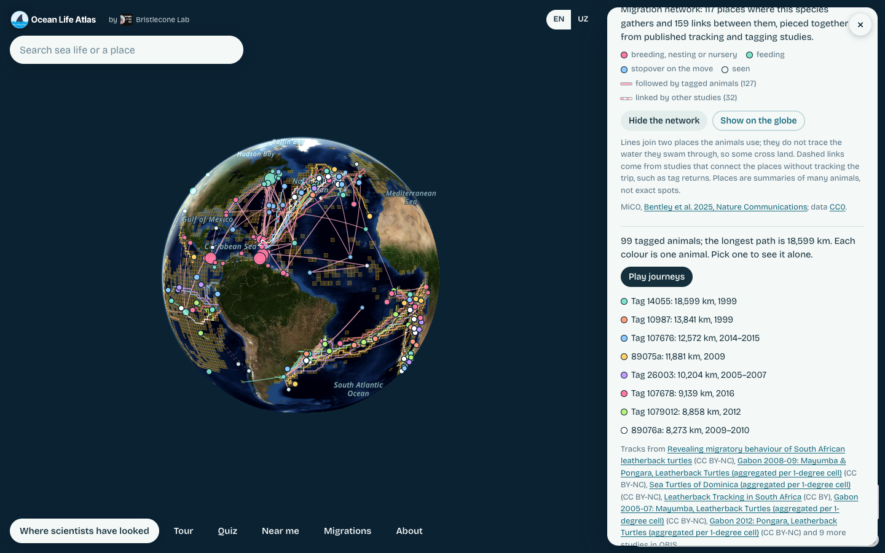
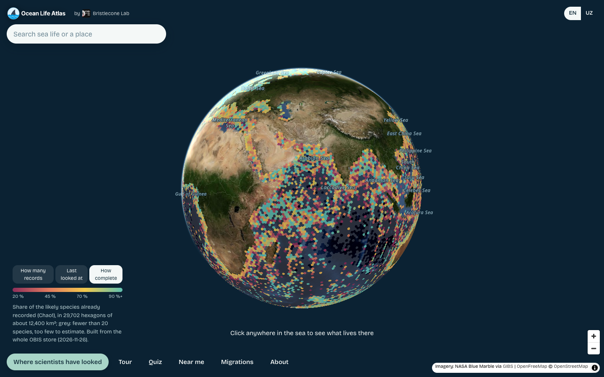

  <a href="https://oceanlife.bristleconelab.org">
    <picture>
      <source media="(prefers-color-scheme: dark)" srcset="public/brand/ocean-life-atlas-logo-dark.svg">
      
    </picture>
  </a>

  <b>Click anywhere in the ocean and see what lives there.</b> 
  A free 3D globe of sea life: photos and plain names, where each animal lives, how deep, how it migrates, 
  and where nobody has looked yet. Built on 200 million open records.

<b><a href="https://oceanlife.bristleconelab.org">oceanlife.bristleconelab.org</a></b>

## What you can do

- **Click the sea:** every species recorded in that 150 km square, with photos, names and Red List status.
- **Search an animal or a place** in English, Uzbek or any language Wikidata knows: its range, depth, water temperature, size and voice.
- **Follow migrations:** networks of 109 species and the real tracks of tagged animals such as leatherback turtles and whale sharks.
- **See the gaps:** where scientists have looked, how long ago, and how complete each area's species list is.
- **Explore:** then and now, two species side by side, a quiz, a guided tour, lists as CSV.

| Migrations and tag tracks | How complete each area is |
|---|---|
|  |  |

A short list usually means few people looked, not that little lives there.

## Data

[OBIS](https://obis.org) (species records), [WoRMS](https://www.marinespecies.org) (names), [Wikidata](https://www.wikidata.org) and
[Wikimedia Commons](https://commons.wikimedia.org) (photos, names, sounds), [Wikipedia](https://www.wikipedia.org) (summaries),
[MiCO](https://doi.org/10.1038/s41467-025-59271-7) (migrations), [Marine Regions](https://www.marineregions.org) (places),
NASA Blue Marble and Sentinel-2 cloudless by EOX (imagery), OpenStreetMap (borders and names).
Each source keeps its own licence (CC0, CC BY or CC BY-SA); photos and tracking studies are credited where they appear.

## Cite

> Ocean Life Atlas (2026). Bristlecone Lab. https://oceanlife.bristleconelab.org. Data: OBIS (2026) Ocean Biodiversity
> Information System, Intergovernmental Oceanographic Commission of UNESCO, https://obis.org.

Code: MIT. Sister atlases: [Seafloor Atlas](https://seaflooratlas.org), [Fauna Atlas](https://fauna.bristleconelab.org).

---

  <a href="https://bristleconelab.org">
    <picture>
      <source media="(prefers-color-scheme: dark)" srcset="public/brand/bristleconelab-mark-dark.svg">
      
    </picture>
    Powered by <b>Bristlecone Lab</b>
  </a>

